<div align="center">

# ANIMAL BALL FIGHTER

한 번의 드래그로 캐릭터를 발사하고  
충돌·스킬·증강을 조합해 방을 돌파하는  
**3D 물리 기반 모바일 로그라이크 액션 게임**

<p>
  
  
  
  
</p>

<p>
  <a href="https://www.youtube.com/watch?v=03Gv5E2kXkA">
    
  </a>
  &nbsp;
  <a href="https://play.google.com/store/apps/details?id=com.oppa073.animalballfighter">
    
  </a>
</p>

</div>

<!-- v0.2.0 시연 영상을 YouTube에 올린 뒤 위 YouTube URL을 새 링크로 교체하세요. -->

---

## 프로젝트 소개

**Animal Ball Fighter**는 캐릭터를 드래그해 발사한 뒤 벽과 적에게 튕기며 전투하는 세로형 Android 게임입니다.

캐릭터별 고유 스킬과 전투 중 획득하는 증강을 조합하고, 매 방 이후 제시되는 경로를 선택해 보스까지 진행합니다. 일반 스테이지 외에도 장기 성장과 기록 경쟁을 위한 무한 모드를 제공합니다.

게임플레이 구현에 그치지 않고 다음 기능을 하나의 모바일 앱 흐름으로 연결했습니다.

- Addressables 기반 콘텐츠 로드와 전투 시작 동기화
- 로컬 저장과 기존 사용자 데이터 호환
- Unity Gaming Services 기반 원격 밸런스·분석·랭킹
- LevelPlay 보상형 광고와 광고 부활
- Unity IAP 거래 ID 기반 중복 지급 차단
- 개인정보 동의, 한국어·영어 전환, Safe Area 대응
- Google Play 정식 출시와 후속 업데이트

<!--
<p align="center">
  
</p>
-->

---

## 개발 정보

| 항목 | 내용 |
|---|---|
| 엔진 | Unity 6000.3.5f2 / URP |
| 언어 | C# |
| 플랫폼 | Android 세로 화면 |
| 빌드 | IL2CPP / ARM64 / AAB |
| 개발 형태 | 개인 포트폴리오 프로젝트 / 1인 개발 |
| 개발 기간 | 2026.06.19 ~ 2026.09 초기 개발, 2026.10 v0.2.0 후속 개발 |
| 현재 버전 | 0.2.0 |
| 배포 | Google Play 정식 출시 |

### 주요 패키지

| 패키지 | 버전 | 용도 |
|---|---:|---|
| Addressables | 2.8.1 | 적·증강 데이터 라벨 로드 |
| Localization | 1.5.13 | 한국어·영어 String Table |
| LevelPlay | 9.5.1 | 보상형 광고 |
| Unity IAP | 5.4.2 | 상품 조회·구매 검증 |
| Authentication | 3.8.0 | UGS 익명 인증 |
| Analytics | 6.3.0 | 동의 기반 플레이 이벤트 기록 |
| Leaderboards | 2.3.4 | 무한 모드 최고 기록 |
| Remote Config | 4.2.5 | 앱 업데이트 없는 밸런스 조정 |

---

## v0.2.0 업데이트

정식 출시 후 직접 확인한 장기 플레이 문제와 첫 사용자 경험을 요구사항으로 다시 정의했습니다.

| 문제 | 적용한 변경 | 확인 기준 |
|---|---|---|
| 증강이 반복될수록 스탯이 지수적으로 증가 | 기본 스탯 기준 누적합과 능력치별 상한 적용 | 반복 선택 시 증가량이 일정한지 확인 |
| 무한 모드 후반 난이도가 낮아짐 | 30방 이후 적 HP·ATK 복리 성장 | 30~50방 이후 난이도 곡선 플레이 확인 |
| 한 판의 선택 폭이 부족함 | 시작 축복, 경로 선택, 상점·휴식·이벤트, 승천 추가 | 각 경로 진입과 런 종료 시 상태 초기화 |
| 신규 사용자가 조작을 알기 어려움 | 행동 완료를 기준으로 진행되는 전투 튜토리얼 추가 | 발사·대시·퍼펙트·스킬 이벤트 확인 |
| 기기 비율에 따라 UI가 잘림 | Safe Area와 9:16 기준 폭 제한 | Galaxy Z Flip6 포함 세로 화면 확인 |
| 운영 기능이 로컬에 한정됨 | UGS 원격 설정·분석·랭킹 연결 | 네트워크 실패 시에도 로컬 진행 유지 |

추가된 주요 콘텐츠:

- 네 번째 캐릭터 **토끼**와 캐릭터별 분기형 스킬 트리
- 무한 모드, 승천 난이도, 시작 축복과 런 골드
- 일반·엘리트·상점·모닥불·이벤트 경로 선택
- 일일 출석과 날짜 기반 일일 미션 3종
- 적 도감, 엘리트 특성, 특수 역할 적
- 퍼펙트 반사, 대시 조준, 뱅크샷과 전투 콤보
- 화면 흔들림·섬광 감소, 진동 설정과 햅틱 피드백
- 개발용 증강 강제 선택·시작 방·능력치 Override 도구

---

## 핵심 문제 해결: 무한 모드 스탯 오버플로

### 문제

기존에는 증강을 선택할 때마다 **이미 증가한 현재값에 다시 비율을 곱했습니다.** 일반 스테이지에서는 선택 횟수가 적어 드러나지 않았지만, 방마다 증강이 쌓이는 무한 모드에서는 스탯이 폭발적으로 증가했습니다.

```csharp
// 이전 방식
Attack *= 1f + value;
MaxHp = Mathf.RoundToInt(MaxHp * (1f + value));
```

공격력 +15% 증강을 반복 선택했을 때의 차이입니다.

| 선택 횟수 | 이전: 현재값 기준 곱연산 | 개선: 기본값 기준 누적합 |
|---:|---:|---:|
| 5회 | 약 2.0배 | 1.75배 |
| 10회 | 약 4.0배 | 2.5배 |
| 20회 | 약 16배 | 4.0배 |
| 40회 | 약 268배 | 7.0배 |

체력은 결국 `int` 최댓값을 넘어 오버플로가 발생했고, 체력 UI와 회복 계산까지 함께 깨졌습니다. 반면 적은 선형으로만 성장해 장기 플레이가 오히려 쉬워지는 문제도 있었습니다.

### 개선

```csharp
// 개선 방식
attackPercentSum += value;
Attack = Mathf.Min(baseAttack * (1f + attackPercentSum), MaxStatValue);
```

- 공격력·최대 체력·스킬 피해를 시작 스탯 기준 누적합으로 변경
- 체력 계산과 회복 과정에 Clamp와 안전 상한 적용
- 치명타 확률 100%, 흡혈 30%, 방 클리어 회복 50% 등 효과별 상한 적용
- 플레이어 주요 스탯 안전 상한 1억 적용
- 무한 모드 30방 이후 적 HP는 방마다 ×1.05, ATK는 ×1.03 복리 성장
- 적 최대 체력 상한 10억 적용

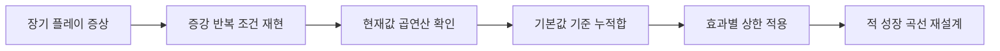

완료된 정적 안전 검사와 Unity 컴파일 확인, 이후 필요한 장기 난이도 플레이 검증을 분리해 관리했습니다.

---

## 플레이 흐름

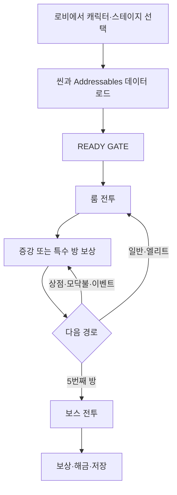

- 3개 스테이지를 진행하며 각 스테이지의 5번째 방에서 보스와 전투합니다.
- 전투 후 일반·엘리트·상점·모닥불·이벤트 중 다음 경로를 선택합니다.
- 무한 모드는 방을 반복하며 최고 도달 방과 누적 골드를 별도로 관리합니다.
- 한 판의 런 골드·증강은 `RunState`, 영구 골드·해금·기록은 `PlayerSaveData`로 분리합니다.

---

## 클라이언트 구조

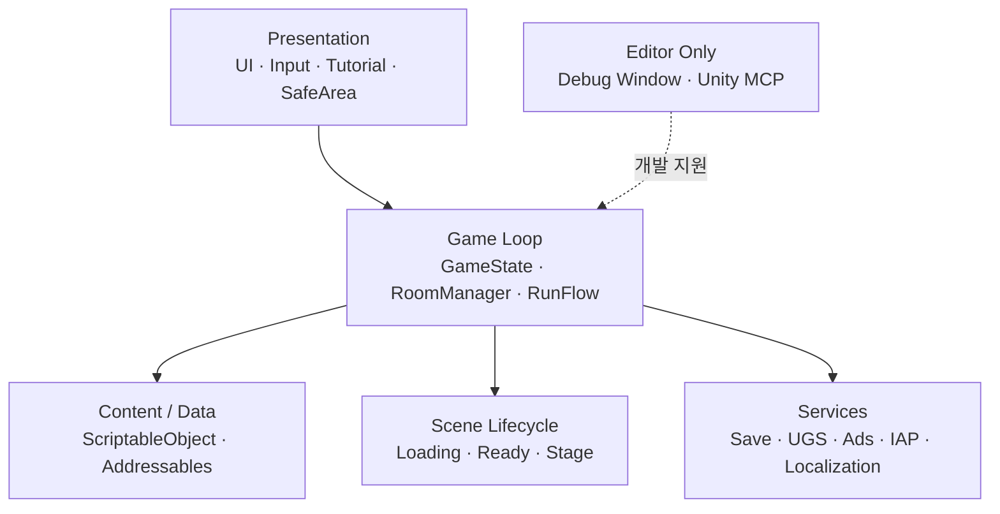

- **Presentation**: 드래그 입력, HUD, 튜토리얼, 모바일 화면 대응
- **Game Loop**: 룸 진행, 전투 상태, 보상과 다음 경로 결정
- **Content / Data**: 캐릭터·적·증강·상태이상 데이터를 에셋으로 관리
- **Services**: 저장, 온라인 서비스, 광고, 결제, 다국어 처리
- **Editor Only**: 반복 테스트와 AI Agent 연동 도구를 Player 빌드에서 분리

---

## 주요 구현

### 1. 드래그 발사와 물리 충돌

드래그 입력을 카메라 기준의 월드 방향으로 변환하고 당긴 거리에 비례한 힘을 `Rigidbody`에 적용합니다.

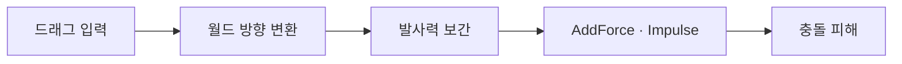

$$Damage = Attack \times 0.6 + Speed \times 0.8$$

- 충돌 당시 공격력과 속도를 함께 사용해 피해 계산
- 벽과 적 충돌 후 Y축 기준 ±18° 각도 보정
- 이동이 멈추면 마지막 진행 방향을 기준으로 상태 복구
- SphereCast 기반 퍼펙트 반사 예측과 다음 충돌 배율 적용
- 길게 눌러 시간을 멈춘 뒤 방향을 지정하는 대시 조준

<!--
<p align="center">
  
</p>
-->

### 2. 데이터 기반 캐릭터·적·증강

캐릭터, 적, 증강과 상태이상 정보를 `ScriptableObject`로 분리하고 실행 로직은 인터페이스와 런타임 클래스로 확장합니다.

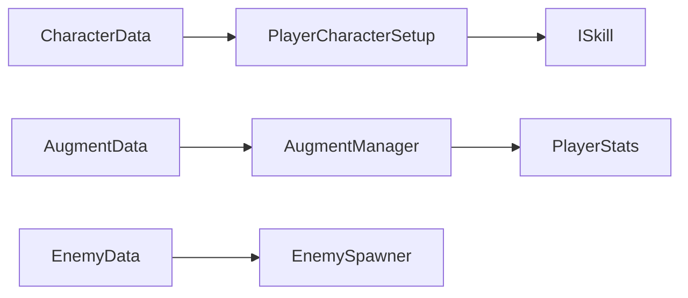

- 고양이·돼지·병아리·토끼의 고유 스킬을 `ISkill` 규격으로 연결
- 증강 후보에서 중복 불가 항목을 제외한 뒤 세 가지를 무작위 제시
- 보유한 증강 스킬이 다시 선택되면 독립 레벨 증가
- `BossPattern` 컴포넌트 단위로 보스의 경고·실행·종료 흐름 분리
- `StatusEffectData`와 `StatusEffectHandler`로 지속 피해와 VFX 관리

### 3. Addressables 로드와 전투 시작 조건

씬 활성화와 콘텐츠 데이터 준비를 별도로 진행하고, 두 조건이 모두 끝났을 때만 전투를 시작합니다.

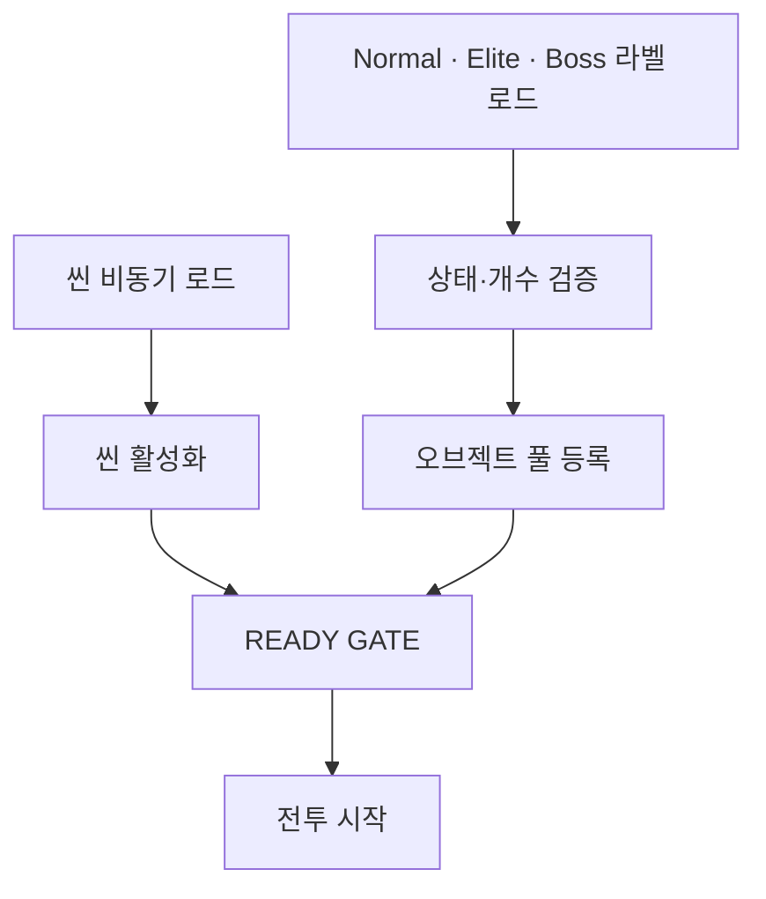

- 역할별 Addressables 라벨로 런타임 적 목록 구성
- 로드 상태와 데이터 개수를 검증한 뒤 오브젝트 풀 등록
- 준비 시간이 10초를 넘거나 필수 데이터가 비어 있으면 전투 차단
- 씬 종료 시 유효한 Addressables Handle 해제
- 로딩 진행률을 씬 로드 0~90%, 준비 확인 90~95%, Fade Out 95~100%로 분리

### 4. 반복 충돌 피드백 요청 병합

전투 코드는 효과음을 직접 실행하지 않고 `CombatFeedbackManager`에 요청만 전달합니다. 매니저는 같은 프레임의 요청을 정리하고 제한된 주기로 대표 요청만 실행합니다.

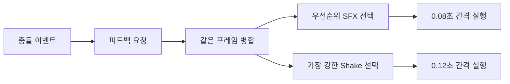

- 같은 프레임의 효과음은 우선순위가 가장 높은 요청만 보관
- 카메라 흔들림은 치명타 충돌에서만 요청
- 겹친 흔들림은 가장 긴 시간과 가장 높은 강도를 유지
- `LateUpdate`에서 실행 후 요청 버퍼 초기화

동일 프레임에 피드백 요청 24회를 발생시킨 Unity Editor 스트레스 조건의 선택 프레임 비교입니다.

| 항목 | 개선 전 | 개선 후 |
|---|---:|---:|
| PlayerLoop | 31.60 ms | 2.31 ms |
| GC Alloc | 75.2 KB | 368 B |
| Audio Voices | 197 | 5 |
| Total Audio CPU | 1.0% | 0.3% |

> 위 수치는 실기기 평균 FPS가 아니라 동일한 Unity Editor 스트레스 조건의 선택 프레임 비교입니다.

### 5. Unity Gaming Services

온라인 기능은 게임을 확장하지만, 초기화나 네트워크 실패가 로컬 전투를 막지 않도록 구성했습니다.

| 서비스 | 구현 내용 | 실패 시 처리 |
|---|---|---|
| Authentication | 익명 로그인과 닉네임 동기화 | 로컬 플레이 유지 |
| Remote Config | 일반 적·보스 HP, 보스 쿨타임, 골드 배율 | 캐시 또는 기본값 1 사용 |
| Analytics | 개인정보 동의 후 플레이 이벤트 기록 | 이벤트만 생략 |
| Leaderboards | 무한 모드 최고 기록 등록·조회 | 로컬 최고 기록 유지 |

Remote Config 값은 `PlayerPrefs`에 캐시하고 0.25~4배 범위로 보정해 잘못된 원격 값이 게임을 무너뜨리지 않게 했습니다.

### 6. 보상형 광고와 부활 상태 복구

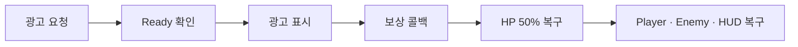

- 개인정보 동의값을 LevelPlay 초기화 전에 전달
- 중복 로드·중복 표시를 상태값으로 차단
- 보상 콜백을 받은 경우에만 골드 또는 부활 실행
- 부활 시 HP뿐 아니라 위치·속도·상태이상·적 상태·게임 상태·HUD를 순서대로 복구
- 광고 부활은 한 플레이당 한 번만 허용

### 7. Unity IAP 중복 지급 차단

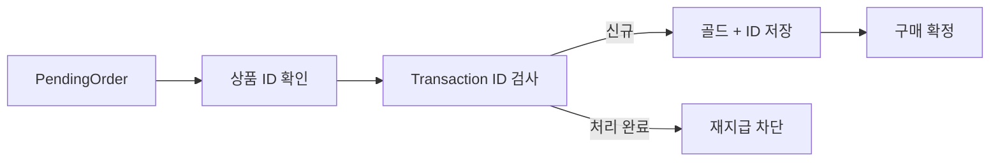

- 상품 ID와 거래 ID를 함께 검증
- 골드와 처리한 거래 ID를 같은 저장 데이터에 기록
- 저장 완료 후 구매 확정
- 동일 거래 콜백이 다시 들어오면 골드를 지급하지 않고 구매만 확정

Unity IAP 구현과 Android 실기기 결제 테스트는 완료했지만, 사업자 등록과 정산 계정 준비 문제로 정식 출시 빌드에서는 판매 기능을 제외했습니다.

### 8. 개인정보·다국어·모바일 UX

- 동의와 거부를 모두 제공하고 결과를 `PlayerPrefs`에 저장
- GDPR 동의 전달 이후에만 광고 SDK 초기화
- Analytics도 같은 동의 상태가 `Granted`일 때만 이벤트 기록
- Unity Localization의 `SelectedLocale`과 `LocaleChanged`로 한국어·영어 UI 갱신
- `Screen.safeArea`와 9:16 기준 폭 제한으로 노치·긴 화면·태블릿 대응
- 화면 흔들림, 섬광 감소, 진동 설정 저장
- Android 햅틱 강도를 전투 이벤트에 따라 구분

---

## AI Agent 활용과 검증

0.2.0 후반 작업에서 **Claude Code·Codex·Unity MCP**를 코드 탐색과 반복 구현을 가속하는 보조 도구로 사용했습니다. 초기 게임 전체를 AI로 만든 것이 아니며, 요구사항과 아키텍처 결정·Diff 승인·Unity 검증·배포 판단은 직접 수행했습니다.

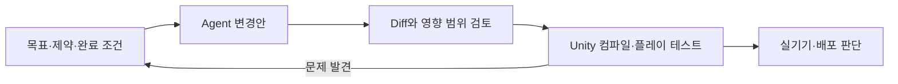

`CLAUDE.md`에 출시 프로젝트의 변경 금지 규칙과 검증 순서를 명시했습니다.

- `PlayerSaveData`의 기존 필드명과 타입은 변경하지 않고 필드 추가만 허용
- 광고·IAP·개인정보 동의 코드는 명시적 요청 없이 수정 금지
- Addressables 라벨 문자열과 콘텐츠 식별자 변경 금지
- 변경 전 계획 작성, 변경 후 라이브 안전 검사와 Unity 검증
- Unity 전처리 심볼이 빠지는 `dotnet build` 대신 Unity Editor에서 컴파일 확인

Unity MCP와 개발용 DLL은 `IFilterBuildAssemblies`와 빌드 후처리로 Player 빌드에서 제거해 개발 도구가 Android 런타임에 포함되지 않도록 했습니다.

---

## 저장 데이터 원칙

- 세이브는 `PlayerSaveData`를 JSON으로 직렬화해 로컬 `PlayerPrefs`에 저장합니다.
- 기존 필드는 이름과 타입을 유지하고 신규 필드는 클래스 끝에 추가합니다.
- 런 전용 데이터와 영구 데이터를 분리해 런 종료 시 임시 효과가 남지 않게 합니다.
- 결제 거래 ID, 캐릭터 해금, 스킬 트리, 일일 미션, 도감과 최고 기록을 영구 데이터로 관리합니다.
- Remote Config 캐시는 별도 키로 저장해 온라인 접속 실패 시 마지막 정상값을 사용합니다.

> 현재 클라우드 세이브는 사용하지 않습니다. 네트워크 실패 시에도 로컬 저장과 플레이가 유지됩니다.

---

## 프로젝트 구조

```text
Assets/
├─ Project/
│  ├─ CoreData/                 # 씬 간 세션 데이터
│  ├─ Save/                     # 로컬 저장 데이터와 SaveManager
│  ├─ ScriptableObjects/        # Character · Enemy · Augment · Stage 데이터 정의
│  └─ Scripts/
│     ├─ Boss/                  # 보스 패턴 컴포넌트
│     ├─ Combat/                # 이벤트 · 콤보 · 히트 피드백
│     ├─ Managers/              # 전투·씬·서비스 관리자
│     ├─ Roguelike/             # RunFlow · RunState · 무한 모드
│     ├─ Services/              # UGS · Remote Config · Analytics
│     ├─ Tutorial/              # 행동 기반 전투 튜토리얼
│     └─ UI/                    # 로비·HUD·랭킹·Safe Area
├─ AddressableAssetsData/       # Addressables 그룹·라벨 설정
├─ Localization/               # 한국어·영어 String Table
└─ Plugins/                    # Android 및 외부 SDK 설정
```

---

<details>
<summary><strong>브랜치·커밋 규칙</strong></summary>

### 브랜치

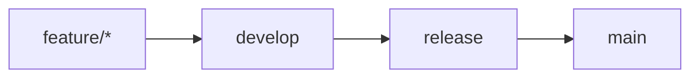

- `main`: 배포 기준
- `release`: 출시 준비와 최종 검증
- `develop`: 기능 통합
- `feature/*`: 기능 단위 작업

### 커밋 메시지

- `Feat`: 기능 추가
- `Fix`: 버그 수정
- `Design`: UI 디자인 변경
- `HOTFIX`: 치명적 오류 긴급 수정
- `Docs`: 문서 수정
- `Refactor`: 코드 구조 개선
- `Test`: 테스트 코드·도구 추가
- `Chore`: 빌드·패키지 설정 변경
- `Rename`: 파일·폴더 이동
- `Remove`: 파일 삭제

</details>

---

<div align="center">

### Animal Ball Fighter

Unity 6 · Android · Version 0.2.0  
Developed by **강한결**

</div>
